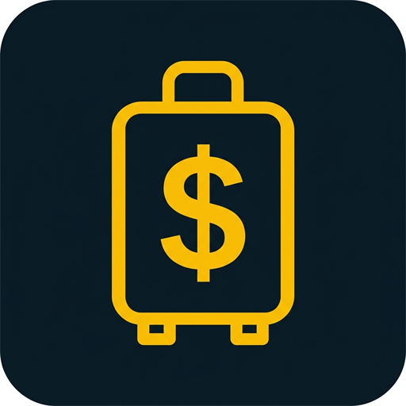
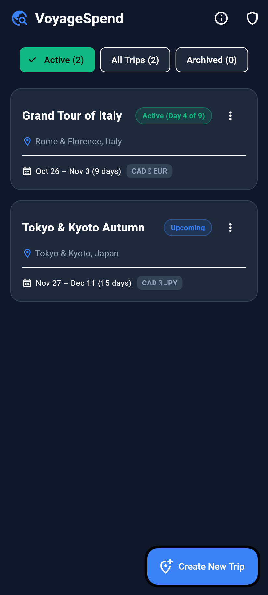
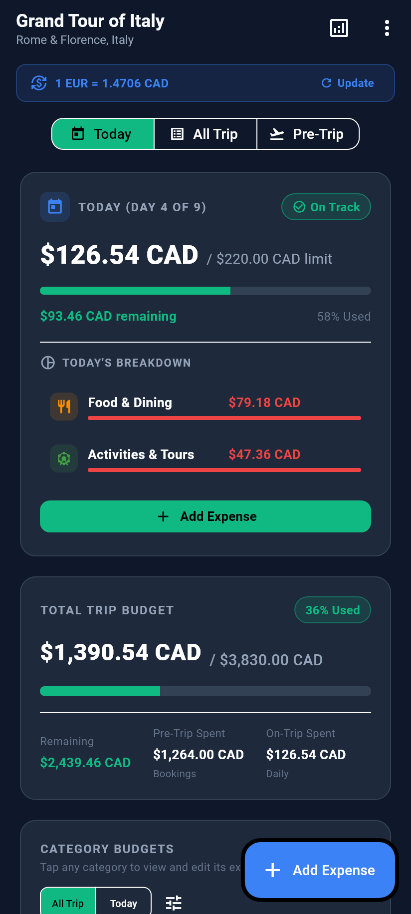
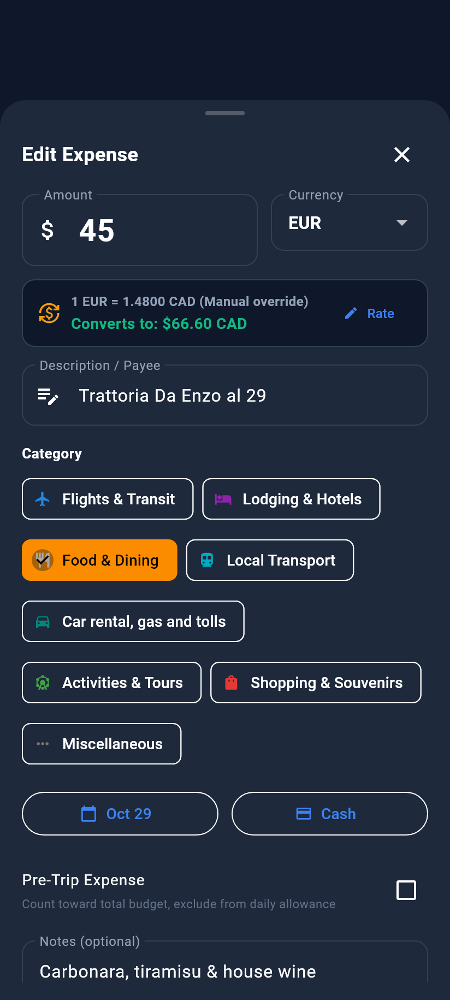
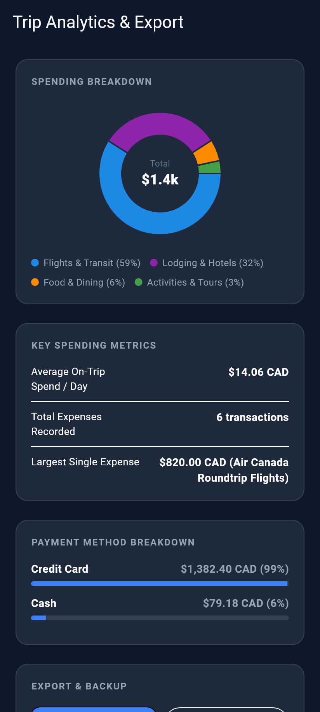
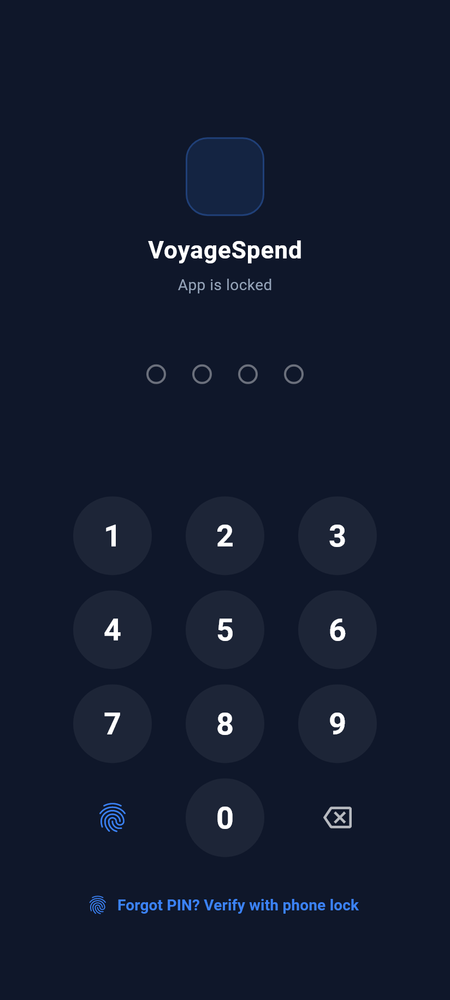
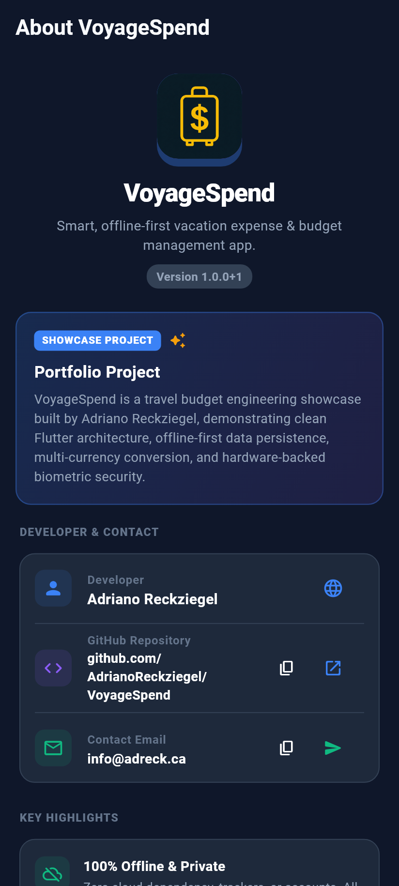

<div align="center">
  
  <h1>VoyageSpend</h1>
  <p><strong>Smart, Offline-First Vacation Budget & Expense Tracker</strong></p>

  [](https://flutter.dev)
  [](https://dart.dev)
  [](https://flutter.dev)
  [](https://adreck.ca)
  [](https://flutter.dev)
  [](lib/l10n)
  [](LICENSE)
</div>

---

## 📖 Overview

**VoyageSpend** (`ca.adreck.voyagespend`) is a mobile application built with **Flutter (Dart)** engineered specifically for travelers to plan, budget, and control vacation spending before departure and while on the road. 

Unlike generic monthly budgeting apps, VoyageSpend is built from the ground up around real travel habits:
* **Bottom-Up Budgeting**: Upfront pre-trip bookings (flights, hotels) are cleanly separated from daily on-the-ground spending limits.
* **Dual Currency & Offline Rates**: Log expenses in destination currency (e.g. `EUR`, `JPY`, `GBP`) with instant live conversions to your home currency (e.g. `CAD`, `USD`), backed by offline rate caching and manual exchange fee overrides.
* **Privacy & Offline First**: Zero cloud logins or accounts required. 100% local persistence with instant launch, local hardware biometrics, and complete data portability (CSV & JSON export).
* **International Ready**: Full multi-language localization supporting English, French, Portuguese, Spanish, and German.

---

## 📸 Screenshots

<div align="center">
  <table>
    <tr>
      <td align="center"><strong>Active & Upcoming Trips</strong></td>
      <td align="center"><strong>Daily Pace & Trip Dashboard</strong></td>
      <td align="center"><strong>Dual-Currency Expense Entry</strong></td>
    </tr>
    <tr>
      <td></td>
      <td></td>
      <td></td>
    </tr>
    <tr>
      <td align="center"><strong>Analytics & Breakdown</strong></td>
      <td align="center"><strong>Biometric & PIN Security</strong></td>
      <td align="center"><strong>Portfolio & Architecture</strong></td>
    </tr>
    <tr>
      <td></td>
      <td></td>
      <td></td>
    </tr>
  </table>
</div>

---

## 🌟 Key Features

### 1. Multi-Trip Management
- Create, manage, switch, and archive multiple vacations.
- Configure trip destination, start and end dates, home base currency, and destination currency.
- **Smart Launch**: Opens directly into **Active & Upcoming trips** by default, with quick-filter chips for `Active`, `All`, and `Archived` trips.
- Safe trip deletion with an interactive confirmation modal.

### 2. Bottom-Up Budgeting Architecture
- **Pre-Trip Allocations**: Fixed allocations for upfront bookings (Flights, Travel Insurance, Hotel Deposits).
- **Daily Targets**: Category daily spending limits (e.g., Food: $65/day, Activities: $35/day, Car rental, gas & tolls: $25/day).
- **Automatic Trip Budget Formula**:
  $$\text{Total Trip Budget} = \sum \text{Pre-Trip Budgets} + \left( \sum \text{Daily Budgets} \times \text{Duration Days} \right) + \text{Buffer}$$

### 3. Pre-Trip vs. On-Trip Expense Isolation
- Expenses incurred before the trip start date are automatically flagged as **Pre-Trip**.
- Pre-trip purchases deduct from the total trip budget and category balances, but **never skew or cut on-the-ground daily spending limits**.

### 4. Dual-Currency Engine with Offline Caching
- Seamlessly handles foreign currency expenses with real-time conversion previews.
- Fetches open exchange rates via API and caches them locally so expense entry works in airplane mode, remote areas, or roaming without data.
- **Manual Rate Override**: Adjust conversion rates per transaction to accurately capture custom ATM fees, exchange booths, or credit card FX surcharges.

### 5. Daily Pace Tracker & Interactive Visualizations
- **Daily Pace Card**: Shows today's limit, today's spending, and real-time status badges (*Under Budget*, *Near Limit*, *Over Budget*).
- **Total Budget Health**: Linear progress bar with visual threshold indicators.
- **Category Progress**: Spent vs. budget progress bars with instant toggle between *Total Trip* and *Today*.
- **Category Breakdown Chart**: Interactive donut chart (`fl_chart`) visualizing expenditure distribution.

### 6. Effortless Expense Editing & Accidental Swipe Protection
- **Tap to Edit**: Tap any transaction in the trip timeline to open a pre-filled edit sheet, modify any field, and immediately see budget metrics recalculate.
- **Swipe-to-Delete Confirmation**: Swiping an expense from right to left presents a safety confirmation dialog to prevent accidental deletions during scrolling.

### 7. App Lock & Biometric Privacy (Offline First)
- **4-Digit Master PIN**: Salted & hashed using SHA-256 and stored inside the hardware KeyStore (`flutter_secure_storage`).
- **Frictionless Biometrics**: Instant biometric unlock (Fingerprint / Face ID via `local_auth`).
- **Device Master Recovery**: If you ever forget your PIN, tap *"Forgot PIN?"* to verify device ownership using your phone's screen lock or fingerprint. 100% offline, zero cloud servers, works anywhere in the world.
- **Smart Auto-Lock**: Configurable timeout (`Immediately`, `After 1 minute`, `After 5 minutes`) when switching between apps.

### 8. Full Multi-Language Localization (i18n / l10n)
- Native localization using standard `.arb` translation files:
  - 🇺🇸 **English** (`en`)
  - 🇨🇦 / 🇫🇷 **French** (`fr`)
  - 🇧🇷 / 🇵🇹 **Portuguese** (`pt`)
  - 🇪🇸 / 🇲🇽 **Spanish** (`es`)
  - 🇩🇪 **German** (`de`)
- Adapts automatically to the user's operating system language preference.

### 9. Full Data Portability & Backup
- **CSV Export**: Generate complete transaction reports for Excel, Google Sheets, or Numbers.
- **JSON Export**: Export full database dumps for backups and device migrations using the native Android share sheet.

---

## 📂 Project Architecture

Organized following clean architecture principles (**MVVM + Repository Pattern**):

```text
lib/
├── data/
│   ├── models/                  # Storage serialization (JSON / NoSQL)
│   ├── repositories/            # TripRepository, ExchangeRateRepository
│   └── services/                # LocalStorageService, ExchangeRateService, ExportService, SecurityService
├── domain/
│   ├── models/                  # Trip, TripCategory, Expense, ExchangeRateMatrix, BudgetSummary
│   └── use_cases/               # BudgetCalculator (pure business logic)
├── l10n/                        # Multi-language ARB templates and generated localizations
│   ├── app_en.arb               # English base template
│   ├── app_fr.arb               # French translation
│   ├── app_pt.arb               # Portuguese translation
│   ├── app_es.arb               # Spanish translation
│   └── app_de.arb               # German translation
├── ui/
│   ├── core/                    # AppColors, AppTheme, CurrencyFormatter
│   └── features/
│       ├── trips/               # Multi-trip listing, creation & status filter chips
│       ├── dashboard/           # Active trip dashboard, overview & daily pace cards
│       ├── expenses/            # Quick-add modal, tap-to-edit sheet & swipe-guarded list tile
│       ├── categories/          # Category targets & custom allowances
│       ├── security/            # App lock gate, biometric unlock, and security settings
│       ├── analytics/           # Category donut chart, metrics & CSV/JSON export
│       └── about/               # About VoyageSpend, portfolio showcase & developer info
└── main.dart                    # Application entrypoint & dependency injection
```

---

## 🛠️ Technology Stack

| Component | Technology | Rationale |
| :--- | :--- | :--- |
| **Framework** | **Flutter 3.x (Dart 3.x)** | High-performance compiled native apps for Android & iOS |
| **Architecture** | **MVVM + Repository** | Strict separation of UI, business logic, and local persistence |
| **Local Persistence**| `shared_preferences` / JSON Document Store | Blazing-fast, zero-friction offline storage with no cloud dependency |
| **Security Storage** | `flutter_secure_storage` | Hardware-backed keystore/keychain encryption for PIN hashes |
| **Biometrics** | `local_auth` | Fingerprint & Face recognition via system authentication |
| **State Management** | `provider` | Reactive state propagation with instant recalculations |
| **Charts** | `fl_chart` | Smooth, customizable interactive donut and bar charts |
| **Networking** | `http` | Lightweight HTTP calls to Open Exchange Rates (`open.er-api.com`) |
| **Formatting & i18n**| `intl` + `flutter_localizations` | Multi-language translation, international currency, and localized dates |
| **Data Export** | `share_plus` + `path_provider` | Native system share sheet for CSV & JSON files |

---

## 📱 Multi-Device Screen Support & Automated Matrix Testing

VoyageSpend is tested against an automated responsive matrix across 7 physical form factors and viewports with **zero layout overflows**:

| Device Profile | Resolution / Viewport | Aspect Ratio / Type | Result |
| :--- | :--- | :--- | :--- |
| **Ultra-Narrow Phone** | 320 x 568 dp | iPhone SE (1st gen) / Compact | Pass (0 Overflows) |
| **Compact Android** | 360 x 640 dp | Galaxy A-series / Moto G | Pass (0 Overflows) |
| **Flagship Phone** | 412 x 915 dp | Google Pixel 8 / 9 / 10 | Pass (0 Overflows) |
| **Tall Modern Phone** | 393 x 852 dp | iPhone 14/15/16 Pro | Pass (0 Overflows) |
| **Foldable Phone** | 673 x 841 dp | Galaxy Z Fold (inner screen) | Pass (0 Overflows) |
| **Android Tablet (10")**| 800 x 1280 dp | Galaxy Tab / Pixel Tablet | Pass (0 Overflows) |
| **Landscape Mode** | 915 x 412 dp | Horizontal Travel Use | Pass (0 Overflows) |
| **Accessibility (1.5x)**| 412 x 915 dp (150% font) | Large System Text Mode | Pass (0 Overflows) |

---

## 🚀 Getting Started

### Prerequisites
- **Flutter SDK** (version 3.0 or higher) — [Install Flutter](https://docs.flutter.dev/get-started/install)
- **Android SDK** (API 30+)

### Setup & Run

1. **Clone the repository**:
   ```bash
   git clone https://github.com/AdrianoReckziegel/VoyageSpend.git
   cd VoyageSpend
   ```

2. **Install dependencies**:
   ```bash
   flutter pub get
   ```

3. **Run on a connected device or emulator**:
   ```bash
   flutter run
   ```

4. **Run Automated Test Suite**:
   ```bash
   flutter test
   ```

---

## 🔒 Privacy & Google Play Store Compliance

- **Privacy Policy**: Hosted online at [`docs/privacy.html`](docs/privacy.html) (suitable for GitHub Pages: `https://adreck.ca/voyagespend/privacy` or `https://adrianoreckziegel.github.io/VoyageSpend/privacy.html`).
- **Release Signing**: Configured in `android/app/build.gradle.kts`. Follow `android/key.properties.example` to sign your release `.aab` (Android App Bundle).

---

## 📄 License

This project is licensed under the MIT License - see the [LICENSE](LICENSE) file for details.
